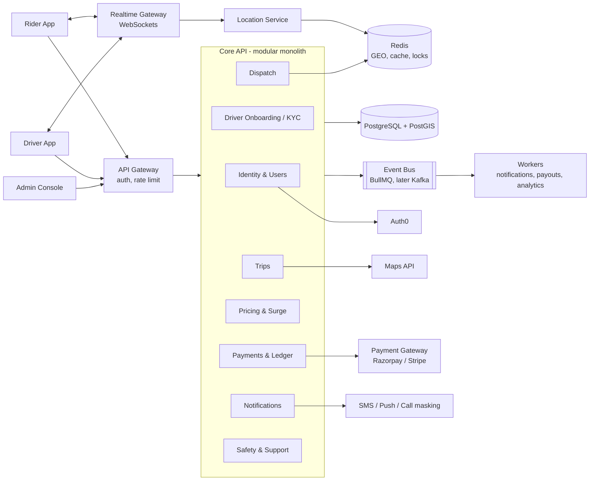

# Ride-Hailing Platform (Node.js)
### Production Roadmap — from zero to a city launch

---

## 1. The Goal

Build a **production-grade ride-hailing platform** (Uber/Ola class) that:

- Lets **riders** book, track, pay for, and rate rides from a mobile app.
- Lets **drivers** onboard with verification, go online, receive ride offers, navigate, and get paid out.
- Matches riders to drivers in **seconds**, using live driver locations.
- Handles **money correctly**: fares, surge, payments, refunds, driver payouts, with an auditable ledger.
- Is **safe and compliant**: verified drivers, trip OTP, SOS, masked phone numbers, India's DPDP Act.
- Is **observable and deployable**: CI/CD, staging, monitoring, alerting, and rollback from day one.

**End state:** A pilot launch in one city, with real drivers and riders, target p95 dispatch time under 10s, target p95 API latency under 200ms, and zero lost or double-charged payments.

---

## 2. Architecture

### Strategy: modular monolith first, then extract services
Every module has hard boundaries (its own tables, and it talks to other modules only through interfaces and events). Services are split out only when load or team size demands it; **location** and **dispatch** are the first candidates. Starting with 10 microservices before the first ride exists is the most common way platforms like this stall.



### Trip state machine

```
SEARCHING → DRIVER_ASSIGNED → DRIVER_ARRIVED → IN_PROGRESS → COMPLETED → PAID
    │              │                 │
    ├→ NO_DRIVER_FOUND               │
    └→ CANCELLED (rider / driver / system, with reason + fee rules)
```
Every transition is validated, persisted with a timestamp and actor, and emitted as an event (`trip.assigned`, `trip.completed`, ...).

### Dispatch flow
1. Driver apps send location every 3–5s → Location Service → Redis `GEOADD`.
2. Rider requests a ride → Dispatch runs `GEOSEARCH` for nearby online drivers → ranks by ETA (not straight-line distance).
3. Offer goes to the best driver with a ~15s timeout; on reject or timeout, try the next one.
4. A **distributed lock** per driver prevents double assignment.

---

## 3. Tech Stack

| Layer | Technology | Notes |
|---|---|---|
| Language | TypeScript (Node.js 22 LTS) | Plain JS won't hold up at this size |
| Framework | NestJS | Enforces module boundaries; runs on Express, so the Auth0 Express setup still applies |
| Auth | Auth0 (OAuth 2.0 / OIDC) | Separate **dev / staging / prod** tenants; roles: rider, driver, admin, support |
| Database | PostgreSQL + PostGIS | Source of truth; service areas, geofences, trip history |
| Cache / Geo | Redis | Live driver positions, locks, rate limits, sessions |
| Queue / Events | BullMQ (Redis) → Kafka later | Start simple, move to Kafka when event volume or consumers grow |
| Realtime | Socket.io with Redis adapter | Horizontally scalable WebSockets |
| Maps | Google Maps Platform / Mapbox / OSRM | Routing, ETA, geocoding; cache aggressively (costly per call) |
| Payments | Razorpay (India) / Stripe | UPI, cards, wallets, driver payouts |
| Notifications | SMS provider, FCM push, call masking (Exotel etc.) | Behind one `NotificationService` interface |
| Mobile apps | React Native or Flutter | Rider + driver apps; background location for drivers |
| Admin | React / Next.js | Ops console: trips, drivers, KYC review, refunds |
| Storage | S3-compatible object storage | KYC documents, encrypted |
| Infra | Docker, Kubernetes (EKS/GKE) or ECS, Terraform | Infrastructure as code from the start |
| CI/CD | GitHub Actions | Lint, test, build, deploy to staging, promote to prod |
| Observability | OpenTelemetry, Prometheus, Grafana, Sentry, pino logs | Tracing across API → workers → external calls |
| Testing | Jest, Supertest, Testcontainers, k6 | Unit, integration, load |

---

## 4. Repository Structure (monorepo)

```
ride-platform/
├── apps/
│   ├── api/                        # Core modular monolith (NestJS)
│   │   └── src/modules/
│   │       ├── identity/           # Users, roles, Auth0 sync
│   │       ├── onboarding/         # Driver KYC, vehicles, document review
│   │       ├── trips/              # State machine, trip lifecycle
│   │       ├── dispatch/           # Matching, offers, timeouts, locks
│   │       ├── pricing/            # Fare rules, surge, promo codes
│   │       ├── payments/           # Charges, refunds, ledger, payouts
│   │       ├── notifications/      # SMS, push, call masking adapters
│   │       ├── safety/             # SOS, trip sharing, incident reports
│   │       └── ratings/
│   ├── realtime/                   # WebSocket gateway + location ingest
│   ├── workers/                    # Queue consumers (notifications, payouts, analytics)
│   ├── admin-web/                  # Ops console
│   ├── rider-app/                  # Mobile
│   └── driver-app/                 # Mobile
├── packages/
│   ├── contracts/                  # Shared types, event schemas, API DTOs
│   ├── config/                     # Env validation, shared config
│   └── observability/              # Logger, tracing, metrics setup
├── infra/
│   ├── terraform/                  # Cloud resources per environment
│   ├── k8s/                        # Manifests / Helm charts
│   └── docker-compose.yml          # Full local stack
├── docs/
│   ├── adr/                        # Architecture decision records
│   └── runbooks/                   # Incident procedures
└── .github/workflows/              # CI/CD pipelines
```

---

## 5. Phase-Wise Plan

### Phase 0 — Foundation (2 weeks)
- [ ] Monorepo, TypeScript, lint/format, commit hooks
- [ ] `docker-compose` with Postgres/PostGIS, Redis
- [ ] CI pipeline: lint → test → build on every PR
- [ ] Env config validation; secrets never in code
- [ ] Auth0: create an **API** (audience), roles, and a separate prod tenant plan
- [ ] Logging, tracing, and error reporting wired in before any features

**Milestone:** Any contributor can run the full stack with one command; CI is green.

### Phase 1 — Identity & Driver Onboarding (3 weeks)
- [ ] JWT verification at the gateway; role-based guards
- [ ] Phone verification (OTP) for riders and drivers
- [ ] Driver onboarding: licence, RC, insurance, photo, bank details
- [ ] Admin KYC review queue (approve / reject with reason)
- [ ] Audit log for every admin action

**Milestone:** A driver can sign up, upload documents, and get approved by an admin.

### Phase 2 — Trips & Dispatch (4 weeks)
- [ ] Service areas as PostGIS polygons (reject requests outside them)
- [ ] Fare estimate: Maps API distance + duration → pricing rules
- [ ] Trip state machine with persisted transitions and events
- [ ] Location ingest → Redis GEO; driver online/offline/heartbeat
- [ ] Dispatch: nearby search, ETA ranking, offer + timeout, per-driver lock
- [ ] **Idempotency keys** on ride requests (no duplicate trips on retries)

**Milestone:** End-to-end ride from request to completion with simulated drivers.

### Phase 3 — Realtime & Apps (4 weeks, parallel with Phase 4)
- [ ] WebSocket gateway, authenticated, scaled via Redis adapter
- [ ] Live driver tracking on rider app; ride offers on driver app
- [ ] Driver app background location + battery-aware update intervals
- [ ] Reconnect and state-resync logic (apps must survive flaky networks)

**Milestone:** Real phones complete a ride on a staging environment.

### Phase 4 — Pricing & Payments (4 weeks)
- [ ] Fare components: base, per-km, per-min, waiting, tolls, taxes
- [ ] Surge by zone (demand vs. supply), with caps
- [ ] Payment gateway integration: UPI, cards, cash trips
- [ ] **Double-entry ledger**: every rupee traceable (rider → platform → driver)
- [ ] Webhook handling with signature verification + idempotency
- [ ] Refunds, cancellation fees, driver payouts, reconciliation job

**Milestone:** Money reconciles to zero difference against the gateway for a full test week.

### Phase 5 — Safety, Notifications & Support (3 weeks)
- [ ] Trip start OTP; SOS button → ops alert + emergency contact
- [ ] Share-trip link for riders
- [ ] Masked calling between rider and driver
- [ ] Push + SMS for every key trip event
- [ ] Ratings, complaints, support tickets in admin console

**Milestone:** Safety features verified on staging; ops team can handle a complaint end-to-end.

### Phase 6 — Hardening & Launch (3–4 weeks)
- [ ] Load test with k6 (target: peak city load ×3)
- [ ] Security review: OWASP checks, dependency scanning, pen test
- [ ] DPDP Act compliance: consent, data retention, deletion requests, data residency review
- [ ] Dashboards + alerts (dispatch time, trip failure rate, payment errors)
- [ ] Runbooks for top incidents; backup + restore drill
- [ ] Pilot in one city with a limited driver pool

**Milestone:** Live pilot with real users, on-call rotation active.

---

## 6. Non-Negotiables

- **Idempotency everywhere money or trips are created.** Mobile networks retry; duplicates cost real money.
- **The ledger is append-only.** Never update a balance in place; balances are derived from entries.
- **Every external call has a timeout, retry policy, and fallback.** Maps, SMS, and payment providers all go down.
- **PII is encrypted at rest and never logged.** Phone numbers, documents, and locations are sensitive data.
- **Schema changes are backward compatible.** Old app versions stay in the wild for months.
- **Feature flags for risky launches.** Surge, new pricing, and new dispatch logic roll out gradually.

---

## 7. Tips to Ship Faster

- **Simulate drivers early.** A script that moves 500 fake drivers around a city lets you build and load-test dispatch without real people.
- **Build the ride loop before the extras.** Promos, scheduled rides, pooling, and loyalty come after the first real ride.
- **Write ADRs for big decisions** (why NestJS, why BullMQ before Kafka). Future you and future hires will need them.
- **Cache maps calls by rounded coordinates.** Maps APIs are one of the largest variable costs at scale.
- **Instrument before optimizing.** You can't fix dispatch latency you aren't measuring.

---

## 8. Later Roadmap
- Kafka event backbone + extract Location and Dispatch into standalone services
- Scheduled rides, ride pooling, multi-stop trips
- Driver incentives and earnings guarantees
- Fraud detection (GPS spoofing, fake trips, promo abuse)
- Multi-city expansion with per-city pricing and regulations
